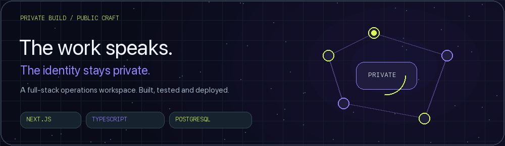

<div align="center">
  
  <br />
  [](https://orbitdropapp.vercel.app)
  [](https://github.com/sasukefrontenddev?tab=followers)
  [](https://github.com/sasukefrontenddev?tab=repositories)
  **[ENTER ORBIT](#02--flagship-transmission)** · **[OPEN THE PLAYGROUND](#04--technology-playground)** · **[READ THE SIGNAL](#06--operating-principles)**
</div>div>
## `01 // The signal`
I build software where **experience, privacy, and engineering discipline** meet. My current flagship is [OrbitDrop](https://github.com/sasukefrontenddev/orbitdrop): a native macOS and Windows workspace for file conversion, compression, and image editing—designed to keep user files on the device.
```text
idea  ──►  interface  ──►  native system  ──►  product people remember
              ▲                                      │
              └──────────── polish + iteration ──────┘
```

## `02 // Flagship transmission`
<table>
  <tr>
    <td width="58%" valign="top">
      <h3>◉ OrbitDrop</h3>h3>
      <p><strong>Private file superpowers, one gesture away.</strong>strong></p>p>
      <p>A desktop-first tool for conversion, meaningful compression, image operations, configurable hotkey interaction, and in-place updates. The product is built as native software—not a web wrapper—and is paired with a focused download and support experience.</p>p>
      <p>
        <a href="https://github.com/sasukefrontenddev/orbitdrop"><strong>Native app →</strong>strong></a>a>
        &nbsp;·&nbsp;
        <a href="https://github.com/sasukefrontenddev/orbitdrop-website"><strong>Web experience →</strong>strong></a>a>
        &nbsp;·&nbsp;
        <a href="https://orbitdropapp.vercel.app"><strong>Live site →</strong>strong></a>a>
      </p>p>
    </td>td>
    <td width="42%" valign="top">
      <h4>Native core</h4>h4>
      <p>
        
        
        
        
      </p>p>
      <h4>Product surface</h4>h4>
      <p>
        
        
        
      </p>p>
      <p><code>LOCAL-FIRST</code>code> <code>PRIVACY-FIRST</code>code> <code>CROSS-PLATFORM</code>code></p>p>
    </td>td>
  </tr>tr>
</table>table>

## `03 // Selected worlds`

<table>
  <tr>
    <td width="50%" valign="top">
      <h3>✦ Trip Deck</h3>h3>
      <p>A trip-planning experience built to turn scattered travel decisions into one clear deck.</p>p>
      <p><a href="https://github.com/sasukefrontenddev/trip-deck">Source</a>a> · <a href="https://trip-deck-five.vercel.app">Live product</a>a></p>p>
      
    </td>td>
    <td width="50%" valign="top">
      <h3>✦ Rava Fitness</h3>h3>
      <p>A digital fitness experience exploring focused product design and responsive interaction.</p>p>
      <p><a href="https://github.com/sasukefrontenddev/rava-fitness">Source</a>a> · <a href="https://rava-fitness.vercel.app">Live product</a>a></p>p>
      
    </td>td>
  </tr>tr>
</table>table>

### ◇ Contrast Check

A small, dependency-free JavaScript utility for calculating color contrast, with a command-line interface, explicit input validation and focused automated tests.

[Explore the source](https://github.com/sasukefrontenddev/contrast-check) · No tracking, network calls or account required.

### ◈ Private build · identity withheld



<table>
  <tr>
    <td width="55%" valign="top">
      <h3>Operational complexity. A clear interface.</h3>h3>
      <p>An administrator-managed platform connecting people, tasks, contributions, documents, schedules and reporting in one responsive workspace.</p>p>
      <p>Multi-sheet spreadsheet imports preserve source details and protect existing edits. Shared records feed dashboards, calendars, team assignments and formatted exports.</p>p>
      <p><strong>The product is private.</strong>strong> Client identity, project name, source repository, deployment address and production screens are intentionally withheld.</p>p>
    </td>td>
    <td width="45%" valign="top">
      <h4>Engineering behind the experience</h4>h4>
      <p><code>NEXT.JS</code>code> <code>REACT</code>code> <code>TYPESCRIPT</code>code> <code>POSTGRESQL</code>code></p>p>
      <p>Server-side access checks · private file storage · schema validation · import deduplication · audited changes · automated tests and builds.</p>p>
      <h4>Polish you can feel</h4>h4>
      <p>Light / Dark / System appearance, motion controls, responsive member cards, live upcoming-event panels and useful failure recovery.</p>p>
      <p><em>Capabilities shared; customer information kept private.</em>em></p>p>
    </td>td>
  </tr>tr>
</table>table>

## `04 // Technology playground`

<div align="center">

  

  *Every tool has a job. Every job becomes part of the experience.*

</div>

<details>
<summary><strong>🍎 Open the native systems room</strong>strong></summary>summary>
<br />


> Building interfaces that feel like they belong to the operating system—not like a webpage wearing a desktop costume.
</details>

<details>
<summary><strong>🎨 Open the interface laboratory</strong>strong></summary>summary>
<br />


> Motion with purpose, responsive layouts, sharp typography, and tiny details that reward exploration.
</details>

<details>
<summary><strong>🚀 Open the launch deck</strong>strong></summary>summary>
<br />


> Test, package, release, observe, refine—and make the next launch smoother than the last.
</details>

<div align="center">

`SWIFT` ✦ `C#` ✦ `TYPESCRIPT` ✦ `REACT` ✦ `NEXT.JS` ✦ `CLOUDFLARE` ✦ `GITHUB ACTIONS` ✦ `VERCEL`

</div>

## `05 // Live telemetry`

<div align="center">

  [](https://github.com/sasukefrontenddev/orbitdrop/releases/latest)
  [](https://github.com/sasukefrontenddev/orbitdrop/commits/main)
  [](https://github.com/sasukefrontenddev/orbitdrop-website/actions)

</div>

> **The numbers above are live GitHub signals—not hand-written trophies.** Real work should tell the story, and the story should stay current.

## `06 // Operating principles`

```yaml
product:
  goal: "make difficult things feel obvious"
  standard: "polished enough to be remembered"
privacy:
  default: "collect less, process locally"
engineering:
  loop: "design → build → test → listen → sharpen"
currently:
  mission: "make OrbitDrop the fastest path from file to outcome"
```

<div align="center">
  
  <h3>Have an ambitious product in mind?</h3>h3>
  <p>Explore the work, report a reproducible issue in the relevant project, or follow the next transmission.</p>p>
  <p><a href="./CONTRIBUTING.md"><strong>Contribution guide →</strong>strong></a>a> · Small fixes, useful feedback and thoughtful collaboration are welcome.</p>p>

  [](https://github.com/sasukefrontenddev)
  [](https://orbitdropapp.vercel.app)

  <sub>Designed and engineered in public · privacy is a feature · details are the product</sub>
</div>
</p></p></tr></tr></p></p></tr></table>
