<div align="center">
  

  <br />

  [](https://orbitdropapp.vercel.app)
  [](https://github.com/sasukefrontenddev?tab=followers)
  [](https://github.com/sasukefrontenddev?tab=repositories)
</div>

## `01 // The signal`

I build software where **experience, privacy, and engineering discipline** meet. My current flagship is [OrbitDrop](https://github.com/sasukefrontenddev/orbitdrop): a native macOS and Windows workspace for file conversion, compression, and image editing—designed to keep user files on the device.

```text
idea  ──►  interface  ──►  native system  ──►  product people remember
              ▲                                      │
              └──────────── polish + iteration ──────┘
```



## `02 // Flagship transmission`

<table>
  <tr>
    <td width="58%" valign="top">
      <h3>◉ OrbitDrop</h3>
      <p><strong>Private file superpowers, one gesture away.</strong></p>
      <p>A desktop-first tool for conversion, meaningful compression, image operations, configurable hotkey interaction, and in-place updates. The product is built as native software—not a web wrapper—and is paired with a focused download and support experience.</p>
      <p>
        <a href="https://github.com/sasukefrontenddev/orbitdrop"><strong>Native app →</strong></a>
        &nbsp;·&nbsp;
        <a href="https://github.com/sasukefrontenddev/orbitdrop-website"><strong>Web experience →</strong></a>
        &nbsp;·&nbsp;
        <a href="https://orbitdropapp.vercel.app"><strong>Live site →</strong></a>
      </p>
    </td>
    <td width="42%" valign="top">
      <h4>Native core</h4>
      <p>
        
        
        
        
      </p>
      <h4>Product surface</h4>
      <p>
        
        
        
      </p>
      <p><code>LOCAL-FIRST</code> <code>PRIVACY-FIRST</code> <code>CROSS-PLATFORM</code></p>
    </td>
  </tr>
</table>

## `03 // Selected worlds`

<table>
  <tr>
    <td width="50%" valign="top">
      <h3>✦ Trip Deck</h3>
      <p>A trip-planning experience built to turn scattered travel decisions into one clear deck.</p>
      <p><a href="https://github.com/sasukefrontenddev/trip-deck">Source</a> · <a href="https://trip-deck-five.vercel.app">Live product</a></p>
      
    </td>
    <td width="50%" valign="top">
      <h3>✦ Rava Fitness</h3>
      <p>A digital fitness experience exploring focused product design and responsive interaction.</p>
      <p><a href="https://github.com/sasukefrontenddev/rava-fitness">Source</a> · <a href="https://rava-fitness.vercel.app">Live product</a></p>
      
    </td>
  </tr>
</table>

## `04 // Build matrix`

<div align="center">

| Product engineering | Native systems | Interface craft | Delivery |
|:---:|:---:|:---:|:---:|
| TypeScript · React · Next.js | Swift · C# · .NET | Motion · responsive UI · UX | GitHub Actions · Vercel · Cloudflare |
| From concept to shipped surface | Desktop-first, OS-aware behavior | Details that make software feel alive | Releases, automation, and iteration |

</div>

## `05 // Live telemetry`

<div align="center">

  [](https://github.com/sasukefrontenddev/orbitdrop/releases/latest)
  [](https://github.com/sasukefrontenddev/orbitdrop/commits/main)
  [](https://github.com/sasukefrontenddev/orbitdrop-website/actions)

</div>

> **The numbers above are live GitHub signals—not hand-written trophies.** Real work should tell the story, and the story should stay current.

## `06 // Operating principles`

```yaml
product:
  goal: "make difficult things feel obvious"
  standard: "polished enough to be remembered"
privacy:
  default: "collect less, process locally"
engineering:
  loop: "design → build → test → listen → sharpen"
currently:
  mission: "make OrbitDrop the fastest path from file to outcome"
```

<div align="center">
  
  <h3>Have an ambitious product in mind?</h3>
  <p>Open a discussion in one of my projects, explore the work, or follow the next transmission.</p>

  [](https://github.com/sasukefrontenddev)
  [](https://orbitdropapp.vercel.app)

  <sub>Designed and engineered in public · privacy is a feature · details are the product</sub>
</div>
